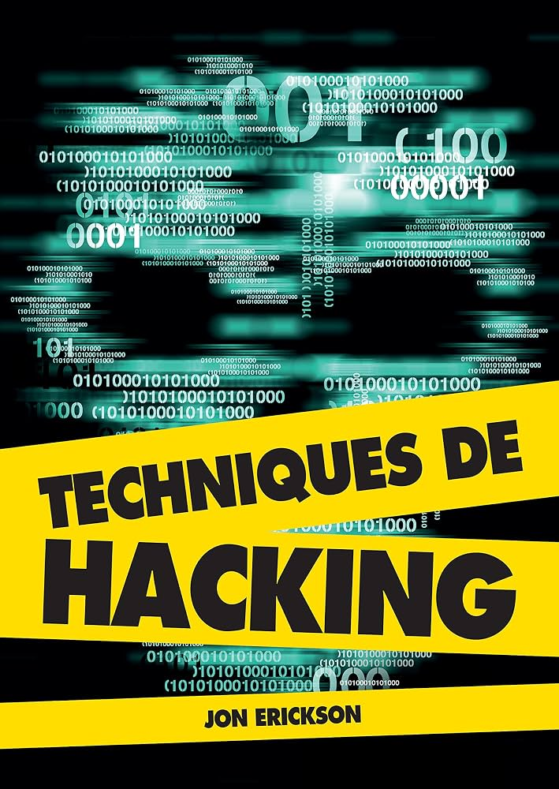

<div style="text-align: center;">
    
</div>

# Transposition des exemples du livre Technique de hacking (Jon ERICKSON) en x64

## Détails
Les exemples en C du livre utilisent une architecture x86-32 sous Linux et présente des techniques de hacking.
Pour travailler sous Windows avec l'IDE Visual Studio Code il faut installer Debian dans wsl et activer l'extension **WSL** dans VSC pour ouvrir l'espace de travail dans wsl.
Il faut également installer l'extension **C/C++** dans wsl cette fois.

- architecture, os et ABI :
```bash
$ gcc -dumpmachine
x86_64-linux-gnu
```
- bibliothèque d'exécution :
```bash
$ ldd --version
ldd (Debian GLIBC 2.36-9+deb12u9) 2.36
Copyright (C) 2022 Free Software Foundation, Inc.
This is free software; see the source for copying conditions.  There is NO
warranty; not even for MERCHANTABILITY or FITNESS FOR A PARTICULAR PURPOSE.
Written by Roland McGrath and Ulrich Drepper.
```

- version de gcc : 14.2.0 :
```bash
$ gcc --version
gcc (Debian 12.2.0-14) 12.2.0
Copyright (C) 2022 Free Software Foundation, Inc.
This is free software; see the source for copying conditions.  There is NO
warranty; not even for MERCHANTABILITY or FITNESS FOR A PARTICULAR PURPOSE.
```

## Réglages
- utilisation de la syntaxe intel pour le désassemblage :
```bash
$ cd ~
$ echo "set disassembly-flavor intel">.gdbinit
```
- vérification dans gdb:
```bash
$ gdb -q
(gdb) show disassembly-flavor 
The disassembly flavor is "intel".
(gdb)
```

## Compilation et debogage dans vsc
- pour compiler : `ctrl + shift + B`
- pour déboguer : `F5`
